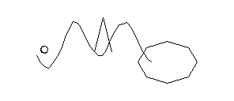
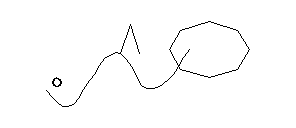
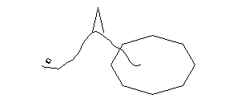
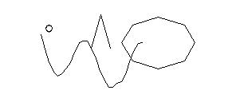
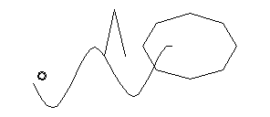

# FishDraw for Badger2040

Procedurally generated fish drawings for the Pimoroni Badger2040 e-ink display.

Each fish is unique and generated from a seed value. Use the buttons to generate new fish, browse history, and explore the infinite varieties of procedurally generated aquatic life.

## Features

- 🐟 **Procedurally Generated**: Every fish is unique based on its seed
- 🎯 **Optimized for MicroPython**: Runs on Badger2040 with minimal resources
- 📱 **Button Controls**: Easy navigation and fish generation
- 💾 **History Tracking**: Store up to 200 generated fish
- ⚙️ **Configurable**: Customize seed steps and history size
- 🎨 **Clean e-ink Display**: Beautiful polyline rendering on 296x128 display

## Example Fish







## Installation

### Requirements

- Pimoroni Badger2040
- MicroPython firmware installed
- USB cable for connection

### Setup Steps

1. **Clone or download this repository**

```bash
git clone https://github.com/neisinger/fishdraw-badger
cd fishdraw-badger
```

2. **Copy files to Badger2040**

Connect your Badger2040 via USB and copy these files to the root directory:
- `main.py` - Entry point (starts automatically on boot)
- `badger2040_fish.py` - Fish generation + display driver (all-in-one)
- `config.json` - Configuration file (optional)

**That's it!** Only 2-3 files needed.

Using Thonny IDE or any MicroPython file manager:
```
main.py → /
badger2040_fish.py → /
config.json → / (optional)
```

3. **Power on or reset the device**

The application will start automatically and display your first fish!

## Button Controls

| Button | Action |
|--------|--------|
| **A** | Decrease seed by step (generate previous fish) |
| **B** | Random seed (generate completely new fish) |
| **C** | Increase seed by step (generate next fish) |
| **UP** | Browse history (previous fish) |
| **DOWN** | Browse history (next fish) |

## Configuration

Edit `config.json` to customize behavior:

```json
{
  "seed_step": 10,
  "history_size": 200,
  "button_delay_ms": 200,
  "display_width": 296,
  "display_height": 128
}
```

- **seed_step**: How much to increment/decrement seed with A/C buttons (default: 10)
- **history_size**: Maximum number of fish to remember (default: 200)
- **button_delay_ms**: Debounce delay for button presses in milliseconds (default: 200)
- **display_width/height**: Adjust for different display sizes (default: 296x128)

## How It Works

### Fish Generation

The algorithm generates fish using:
1. **Perlin Noise**: Creates organic, wave-like body shapes
2. **Seeded Random**: Same seed always produces identical fish
3. **Procedural Parameters**: Body length, height, wave count determined by seed
4. **Body Parts**: Main body, eyes, dorsal fin, ventral fin, tail

### Seed System

Each fish is defined by a single integer seed. The same seed always generates the identical fish, making it easy to share and remember your favorites.

Examples:
- Seed `12345` → Always generates the same fish
- Seed `67890` → Generates a completely different fish
- Use buttons to explore nearby seeds and find varieties you like

### History

The device remembers up to 200 previously generated fish. Press UP/DOWN to browse through your history without regenerating them.

## Architecture

```
main.py (entry point)
    ↓
badger2040_fish.py (all-in-one)
    ├─ SeededRandom (deterministic RNG)
    ├─ SimpleNoise (hash-based noise)
    ├─ generate_fish() (fish generation)
    └─ BadgerFish class (display & UI)
        ├─ Button handling
        ├─ Display rendering via badger.line()
        └─ Seed history management
```

Single file = simpler deployment!

## File Structure

```
.
├── main.py                    # Entry point - copy to Badger2040
├── badger2040_fish.py         # Fish generation + display driver (all-in-one)
├── config.json                # Configuration file (optional)
├── samples/                   # Example generated fish
│   ├── fish_001_12345.png
│   ├── fish_002_67890.png
│   └── ...
├── README.md                  # This file
└── LICENSE                    # MIT License
```

**Only copy the first 3 files to Badger2040!**

## Technical Details

### Display Rendering

- **Resolution**: 296 × 128 pixels (Badger2040 native)
- **Color**: Black and white (e-ink)
- **Rendering**: Polyline drawing via `badger.line()`
- **Update Method**: Full display update for each fish

### Memory Efficiency

- **Single file**: No import overhead
- **~10 KB memory per fish**: Hash-based noise instead of Perlin arrays
- **Can store 200 fish**: Seeds only (5-10 bytes each)
- **Instant generation**: No malloc failures on Badger2040

### Performance

- **Generation Time**: ~1-2 seconds per fish (MicroPython)
- **Display Update**: ~2-3 seconds (e-ink refresh)
- **Button Response**: ~200ms debounce

## Troubleshooting

### Fish not displaying

1. Check that `badger2040_fish.py` and `fishdraw.py` are on the device
2. Verify button constants match your firmware version
3. Check display initialization in console output

### Out of memory errors

1. Reduce `history_size` in `config.json`
2. Restart the device (garbage collection)
3. Check available storage with `import os; os.listdir()`

### Buttons not responding

1. Verify button constants: A=3, B=2, C=1, UP=10, DOWN=11
2. Check `button_delay_ms` is set appropriately (not too low)
3. Ensure proper firmware version with button support

## Original Work

Based on [fishdraw](https://github.com/LingDong-/fishdraw) by LingDong - an amazing procedural fish generator.

## License

MIT License - See LICENSE file for details

## Contributing

Found a bug? Want to improve something? Feel free to open an issue or submit a pull request!

Happy fish hunting! 🐟
