# fishdraw

*procedurally generated fish drawings for 296x128 displays*

[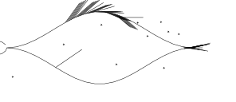](samples/000020.svg)

- generates diverse procedural fish in real-time
- optimized for Badger2040 e-ink display (296x128 resolution)
- full procedural generation with no external dependencies
- outputs polylines (supported formats: SVG, JSON, CSV, etc.)
- single file implementation
- displays finished fish (no animation overhead)
- **interactive button controls for Badger2040** (A/B/C buttons + up/down)


## installation

### Badger2040 Setup (3 simple steps)

1. **Flash MicroPython** on your Badger2040 (once):
   - Download the latest MicroPython `.uf2` from [Pimoroni releases](https://github.com/pimoroni/badger2040/releases)
   - Hold the BOOT button and plug in USB
   - Drag and drop the `.uf2` file to the mounted drive

2. **Copy 4 files** to your Badger2040:
   ```bash
   rshell cp main.py /pyboard/
   rshell cp badger2040_fish.py /pyboard/
   rshell cp fishdraw_complete.py /pyboard/
   rshell cp config.json /pyboard/
   ```
   
   **Note:** `fishdraw_complete.py` is compatible with MicroPython (no external dependencies).

3. **Done!** Unplug and reconnect - it will start automatically.

### Configure (optional)

Edit `config.json` on your device:
```json
{
  "seed_step": 10,           # How much A/C buttons change seed
  "history_size": 200,       # How many fish to remember (only stores seeds!)
  "button_delay_ms": 200,    # Debounce delay (ms)
  "display_width": 296,
  "display_height": 128
}
```

**Note on history:** Only the seed is stored (~10 bytes per fish), so you can safely store 100+ fish without memory issues! The fish is regenerated from the seed when you navigate back to it.

### Local Testing

Test without hardware:

```bash
# Python - simulation mode
python3 badger2040_fish.py
# Commands: a b c u d s q (button A/B/C, up, down, status, quit)

# JavaScript - generate SVG
node fishdraw.js --seed "Test Fish"
```

## usage

### JavaScript

Generate and output as SVG:

```bash
node fishdraw.js > output.svg
```

Specify seed for consistent fish:

```bash
node fishdraw.js --seed "Biggus fishus" --format smil --speed 2 > output.svg
```

Use as JavaScript library:

```js
const {fish, generate_params, main} = require('./fishdraw.js');
let polylines = main("My Fish", 296, 128);  // 296x128 display resolution
console.log(polylines);
```

### Python (for Badger2040)

Generate and display fish on Badger2040:

```python
from badger2040_fish import BadgerFish

badger = BadgerFish(config_path="config.json")
badger.run()  # Interactive mode with button controls
```

Or use programmatically:

```python
from badger2040_fish import BadgerFish

badger = BadgerFish()
badger.generate_and_display("MyFish")
badger.button_a_pressed()  # Decrease seed
badger.button_b_pressed()  # Random seed
badger.button_c_pressed()  # Increase seed
badger.button_up_pressed()  # Previous fish in history
badger.button_down_pressed()  # Next fish in history
```

Generate drawing as Python polylines:

```python
from fishdraw_complete import main

polylines = main("TestFish", 296, 128)  # optimized for 296x128 display
```

### Badger2040 Button Controls

When running on a Badger2040 device, use the buttons to control the fish:

| Button | Action |
|--------|--------|
| **A** | Decrease seed by configured step (default: 10) |
| **B** | Generate random seed (new fish) |
| **C** | Increase seed by configured step (default: 10) |
| **UP** | Navigate to previous fish in history |
| **DOWN** | Navigate to next fish in history |

### Configuration

Create a `config.json` file to customize behavior:

```json
{
  "seed_step": 10,
  "history_size": 20,
  "button_delay_ms": 200,
  "display_width": 296,
  "display_height": 128,
  "simulation_mode": true
}
```

**Configuration options:**

- `seed_step`: Amount to increment/decrement seed with A/C buttons (default: 10)
- `history_size`: Maximum number of seeds to keep in history (default: 20)
- `button_delay_ms`: Minimum delay between button presses in milliseconds (default: 200)
- `display_width`: Display width in pixels (default: 296)
- `display_height`: Display height in pixels (default: 128)
- `simulation_mode`: Enable simulation mode for testing (default: true)

### Command-line options (JavaScript)

- `--seed "name"`: Use specific seed string for reproducible fish. The seed determines all procedural parameters and fish characteristics.
- `--format`: Output format (default: `svg`)
  - `svg`: Regular SVG drawing
  - `json`: JSON polyline data
  - `csv`: CSV format (one polyline per line)
  - `smil`: Animated SVG (for web display)
- `--speed`: Animation speed multiplier (default: 1.0, only affects `smil` format)
- `--width`: Display width in pixels (default: 296)
- `--height`: Display height in pixels (default: 128)

### Parameters

The `main()` function accepts display dimensions:

```javascript
main(seed, width, height)  // default: 296x128 (Badger2040 resolution)
```

This automatically scales and centers the fish for the target display.


## how it works

1. **Procedural generation**: Uses Perlin noise and parametric curves to generate unique fish shapes
2. **Seeded randomness**: String seeds are converted to reproducible random values
3. **Display optimization**: Automatically scales and centers the fish for 296x128 displays
4. **Finished rendering**: Outputs complete drawings (no incremental drawing steps needed)
5. **Polyline format**: All output is polylines - perfect for plotters and e-ink displays
6. **History tracking**: Only stores seeds (~10 bytes each), fish are regenerated on demand

### Why only seeds in history?

Each seed produces the **exact same fish** every time (deterministic). So instead of storing the entire fish drawing (thousands of bytes), we only store the seed string (10-20 bytes). This means:

- **20 fish**: ~0.2 KB
- **100 fish**: ~1 KB  
- **200 fish**: ~2 KB
- **1000 fish**: ~10 KB

Memory is not a constraint! The default is now 200 fish, but you can increase it as much as you want.


## output formats

### SVG (default)
Standard scalable vector graphics - view in any browser or vector editor

### JSON
Raw polyline coordinates for programmatic use:
```json
[
  [[x1, y1], [x2, y2], ...],
  [[x3, y3], [x4, y4], ...],
  ...
]
```

### CSV
One polyline per line, comma-separated coordinates:
```
x1,y1,x2,y2,x3,y3,...
x4,y4,x5,y5,...
```

### SMIL
Animated SVG for web display with configurable animation speed


## gallery

Sample fish generated with various seeds. Click any image to view it larger:

| | | | |
|---|---|---|---|
| [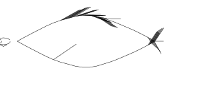](samples/000000.svg) | [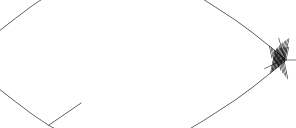](samples/000001.svg) | [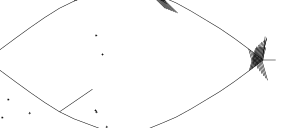](samples/000002.svg) | [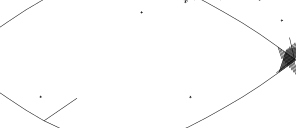](samples/000003.svg) |
| [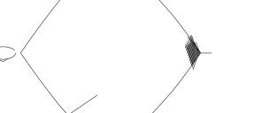](samples/000004.svg) | [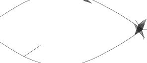](samples/000005.svg) | [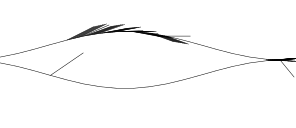](samples/000006.svg) | [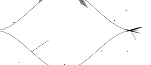](samples/000007.svg) |
| [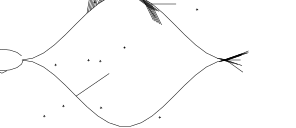](samples/000008.svg) | [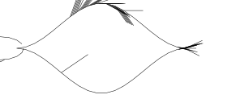](samples/000009.svg) | [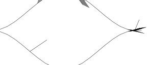](samples/000010.svg) | [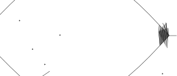](samples/000011.svg) |
| [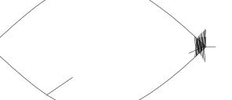](samples/000012.svg) | [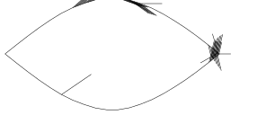](samples/000013.svg) | [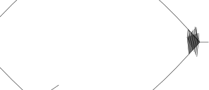](samples/000014.svg) | [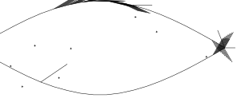](samples/000015.svg) |
| [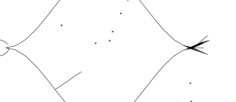](samples/000016.svg) | [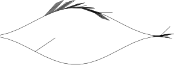](samples/000017.svg) | [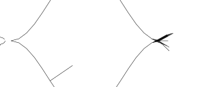](samples/000018.svg) | [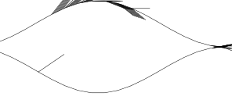](samples/000019.svg) |
| [](samples/000020.svg) | [](samples/000021.svg) | [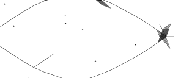](samples/000022.svg) | [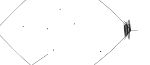](samples/000023.svg) |
| [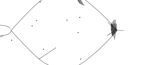](samples/000024.svg) | [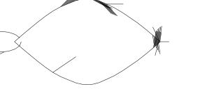](samples/000025.svg) | [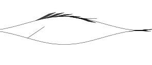](samples/000026.svg) | [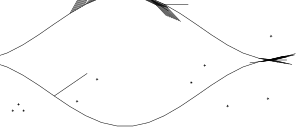](samples/000027.svg) |
| [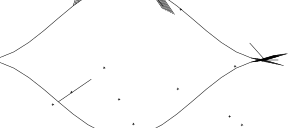](samples/000028.svg) | [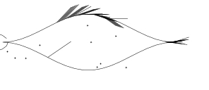](samples/000029.svg) | [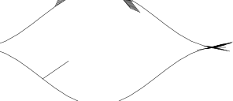](samples/000030.svg) | [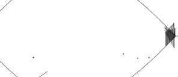](samples/000031.svg) |
